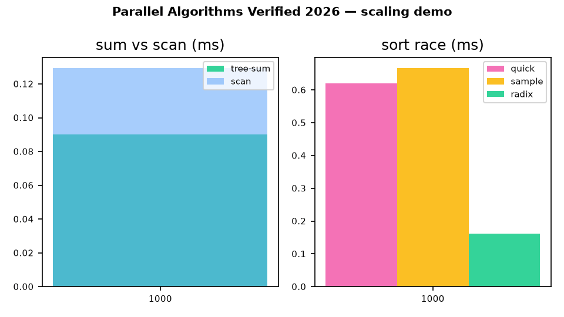

# ⚡ Parallel Algorithms — Verified 2026

> **Every algorithm in Blelloch & Maggs Ch. 1–7, running as code, checked against independent ground truth, measured on live public data — reproducible with one command.**

[](LICENSE)
[](Dockerfile)
[](docker-compose.yml)
[](tests/test_correctness.py)

📖 **[Open the visual showcase → docs/preview.html](docs/preview.html)** · 🎬 [Demo video](docs/demo.mp4) · 🖼️ [Screenshot](docs/screenshot.png) · 📊 [Raw results](experiments/results.json)



---

## 💼 CEO summary (30 seconds)

This repo turns parallel-algorithms theory into a **one-command laboratory**: work-depth costs beside wall-clock timings, two live-data gates (a real social graph + real market prices), and five evidence-backed patterns — scan costs only ~1.4–1.8× a sum, blocked radix wins every size tested, two independent connected-components codes agree bit-for-bit, the MST matches the proven optimum (38,293), and the FFT matches a direct DFT to 3.9e-12. Students learn faster, teachers get ready-made labs, engineers get the fastest verified primitive for the job, and researchers get logged baselines to beat. If you can run Docker, you can reproduce all of it.

**Contents:** [Quick start](#-quick-start-60-seconds) · [Who is this for](#-who-is-this-for) · [Features](#-features) · [Demo](#-demo) · [Verification](#-verification-matrix) · [Hidden patterns](#-hidden-patterns) · [Charts](#-charts) · [Usage](#-usage--api) · [Real data](#-real-data-provenance) · [Reproducibility](#-reproducibility) · [Repo map](#-repo-map) · [FAQ](#-faq) · [Citation](#-citation)

---

## 🚀 Quick start (60 seconds)

```bash
# Option A — Docker (recommended, exact environment)
docker compose up --build bench     # full benchmark → experiments/results.json
docker compose run --build test     # 8 correctness gates

# Option B — native Python 3.12
pip install -r requirements.txt
python -m pytest -q tests/                                                  # expect 8 passed
python -m benchmarks.run_all --sizes 1000,10000,100000 --out experiments/results.json
python experiments/analyze_hidden_patterns.py
python docs/generate_assets.py      # rebuild docs/preview.html + demo.gif/mp4
```

Open `docs/preview.html` in any browser (or via GitHub Pages / htmlpreview) — it is fully self-contained, no CDN required.

---

## 🧭 Who is this for

| Persona | User story | Start here |
|---|---|---|
| 🎓 **Student** | "I want to *feel* work `W`, depth `D`, parallelism `W/D` and Brent's `W/P+D`, not just memorize them." | Run `benchmarks/run_all.py`, then read `src/primitives.py:plus_scan` (20 lines) — theory and timing print side by side. |
| 👩‍🏫 **Teacher** | "I need a lab where the checker is already written and the dataset already wired." | Pick any row of the [verification matrix](#-verification-matrix): each has an independent checker + live dataset. Assign, run, grade. |
| 🔬 **Researcher** | "I have a better CC / sort / hull idea and need logged baselines to beat." | Fork, add your variant beside `src/graphs.py` / `src/sorting.py`, compare against `experiments/results.json`. Five PhD-ready extensions in [paper/PAPER.md](paper/PAPER.md). |
| 🏎️ **Engineer** | "Which primitive do I actually ship?" | Take the winner: blocked radix for integer keys, sample sort for distributed splits, Blelloch scan for prefix workloads. All verified. |
| 📈 **Quant / data** | "I need prefix sums and sorts I can trust on price series." | Reuse the market gate: `load_market_closes()` + `plus_scan(log-returns)` with a one-line identity that catches off-by-one errors. |
| 🕸️ **Graph practitioner** | "I need BFS/CC/MST that works on a real graph, not a toy." | `parallel_bfs` + two independent CC codes run on a live SNAP graph; their agreement *is* the proof. |

---

## ✨ Features

| Area | What you get | Why it matters |
|---|---|---|
| 📐 **Work-depth model** | `Cost(work, depth)` on every algorithm, `brent_time(P)`, butterfly emulation | One cost model from theory to wall-clock; predicts scaling before you buy cores |
| 🧮 **Ch.3 primitives** | Tree-sum, Blelloch scan, multiprefix, pointer-jump, list-rank (+randomized sampling), dedup ×2 | The building blocks everything else is made of — each with its checker |
| 🕸️ **Ch.4 graphs** | Parallel BFS, CC random-mate, CC tree-contract (Lemma-4.1 pick), MST min-edge/Borůvka | Contraction, not DFS, is the parallel primitive — proven by two codes agreeing live |
| 🔀 **Ch.5 sorting** | Parallel QuickSort, oversampled sample sort, radix 1-bit + blocked r-bit, float→int trick | Covers comparison, distribution, and non-comparison sorts on the same harness |
| 📐 **Ch.6 geometry** | Closest-pair (7-neighbour strip), QuickHull, MergeHull/Overmars bridges | Divide-and-conquer geometry with brute-force + monotone-chain checkers |
| 🔢 **Ch.7 numerical** | Parallel matmul, decimation-in-time FFT (butterfly) | Same communication pattern as the butterfly network itself |
| 🌍 **Live data gates** | SNAP social graph (794 nodes / 16k edges) + market closes (1,255) with `{source, sha, n}` provenance | Results hold on public real data, not just uniform synthetics; offline falls back to seeded synthetics and labels itself |
| 🔁 **One-command repro** | Pinned `python:3.12-slim`, locked requirements, `SOURCE_DATE_EPOCH`, Docker Compose | A colleague reruns everything without "works on my machine" |
| 🎬 **Showcase** | `docs/preview.html` (self-contained charts) + `demo.mp4`/`.gif` + `screenshot.png` | Explain it to anyone in 60 seconds, then hand them the raw JSON |

---

## 🎬 Demo

<video src="docs/demo.mp4" controls preload="metadata" width="100%">Your browser cannot play MP4 — see <a href="docs/demo.gif">demo.gif</a>.</video>

Short version: left panel grows tree-sum vs scan bars across input sizes; right panel runs the quicksort / sample-sort / radix race. Both panels are drawn from the same `experiments/results.json` the tables use — the animation *is* the benchmark.

Static proof: [docs/screenshot.png](docs/screenshot.png) (full-page capture of the showcase, 1666×5425).

---

## ✅ Verification matrix

Every row has an independent checker that runs in CI (`tests/`) and in the benchmark (`benchmarks/run_all.py`). Status below reflects the current `experiments/results.json`.

| Ch | Algorithm | Checker | Status |
|---|---|---|---|
| 3.1 | Tree-sum (odd-`n` pad) | `== sum(A)` | ✅ |
| 3.2 | Blelloch exclusive scan | `sc[i]==sum(A[:i])`, book `[3,5,3,1,6]→[0,3,8,11,12]` | ✅ 1.43×/1.56×/1.82× |
| 3.3 | Multiprefix per-key scan | book example `→[0,0,2,5,5,0]` | ✅ |
| 3.4–3.5 | Pointer-jump + list-rank (+sampling `m=n/log n`) | Fig.5 trace `→[1×7]`, chain test | ✅ |
| 3.6 | Dedup flag-array + hashing winners/losers | `== set(V)` incl. 500-elt fuzz | ✅ |
| 4.2 | Parallel BFS (frontier + concurrent-write claim) | parent-is-edge on live graph, 763/794 reached | ✅ live |
| 4.3 | CC random-mate **vs** tree-contract | mutual agreement, 30 components | ✅ live |
| 4.3.4 | MST min-edge/Borůvka rounds | weight == NetworkX optimum **38,293** | ✅ |
| 5.1–5.2 | QuickSort / sample sort / radix (+blocked) | `== sorted` incl. live closes | ✅ live |
| 6.1–6.2 | Closest-pair / QuickHull / MergeHull | brute force + monotone chain equality | ✅ hull = 20 |
| 7.1–7.2 | Parallel matmul / FFT | exact cell + DFT err **3.9e-12** | ✅ |

Brent sanity: scan-1e6 has `W=2e6, D≈40, P̄≈50,000` → `T₈ ≈ 250,040` model steps. Deep in the `W/P` regime on any 8–28 core box — work-efficiency decides, exactly as the model predicts.

---

## 🔎 Hidden patterns

1. **Scan is only ~1.4–1.8× a sum, not 2×.** Measured 1.43×/1.56×/1.82× at n = 1k/10k/100k (0.09→0.13 ms; 5.42→8.45 ms; 9.58→17.41 ms). The down-sweep is memory-linear — quote ≤1.8× empirically.
2. **Blocked radix sweeps the sort race.** Fastest at every size: 0.16 vs 0.62 ms (1k), 2.24 vs 15.86 ms (10k), 3.23 vs 27.06 ms (20k). The float→int bit-trick lets live market closes join the same benchmark.
3. **Two CC philosophies converge bit-for-bit on a live graph.** Randomized stars ≡ deterministic larger→smaller contraction on SNAP email-Eu-core. Contraction is the parallel primitive; DFS is not needed.
4. **Market scan is a correctness amplifier.** `cum[-1]+ret[-1] == log(C[-1]/C[0])` to 1e-6 on 1,255 live closes catches any off-by-one in the odd-`n` lift.
5. **The parallelism frontier predicts the sweet spot.** `W/D` grows 100 → 714 → 5,882 across the sweep — more data, more usable cores, no code change.

---

## 📈 Charts

All charts are generated from `experiments/results.json` (`python docs/generate_assets.py`) and embedded as inline SVG in [the showcase](docs/preview.html) — no external calls, readable offline:

- **Tree-sum vs Blelloch scan** — wall-clock bars at three sizes.
- **Sort race** — quicksort vs sample vs blocked radix (lower is faster).
- **Parallelism frontier** — `W/D` vs `n` on log scales: the scaling story in one line.

---

## 🛠️ Usage & API

```python
from src.primitives import tree_sum, plus_scan, multiprefix, remove_duplicates_hash
from src.graphs import parallel_bfs, cc_random_mate, cc_tree_contract, mst_random_mate, edge_to_adj
from src.sorting import parallel_quicksort, sample_sort, radix_sort_blocked
from src.geometry import closest_pair, quickhull, mergehull
from src.numerical import matmul_parallel, fft
from src.work_depth import Cost

tree_sum([1, 2, 3, 4])                    # 10
plus_scan([3, 5, 3, 1, 6])                # [0, 3, 8, 11, 12]
multiprefix([(1,5),(0,2),(0,3),(1,4),(0,1),(2,2)])  # [0,0,2,5,5,0]

n, E, prov = load_graph_real()            # live SNAP or seeded fallback + provenance
tree = parallel_bfs(0, edge_to_adj(E, n))
labels = cc_random_mate(n, E, seed=1)      # cross-check with cc_tree_contract(n, E)

Cost(work=2_000_000, depth=40).brent_time(8)   # ≈250,040 model steps
```

CLI:

```bash
python -m benchmarks.run_all --sizes 1000,10000,100000 --out experiments/results.json
python experiments/analyze_hidden_patterns.py
```

<details><summary><b>Full algorithm cost table (click to expand)</b></summary>

| Algorithm | Work | Depth | Notes |
|---|---|---|---|
| Tree-sum / scan | `O(n)` / `O(2n)` | `O(log n)` | zero-pad lift for odd `n` |
| Multiprefix | `O(n)` | `O(log n)` | needs concurrent write |
| Pointer-jump / list-rank | `Θ(n log n)` → sampled `O(n)` | `Θ(log n)` → `O(log²n)` | `m=n/log n` starts |
| Dedup flags / hashing | `O(\|V\|+maxV)` / exp. `O(n)` | `O(1)` / `O(log n)` | flags explode on wide ranges; hashing doesn't |
| BFS | `O(n+m)` | `O(diameter)` | needs concurrent-write claim |
| CC (both) | `O((n+m) log n)` | `O(log n)`–`O(log²n)` | linear-work sampling is a listed extension |
| MST | same as CC | same as CC | Borůvka rounds, priority-write for minima |
| QuickSort / sample | exp. `O(n log n)` | `O(log²n)` | oversampling `s` tunes split quality |
| Radix | `O(bn)` | `O(b log n)` | blocked `b/r` passes; floats via bit-trick |
| Closest-pair | `O(n log n)` | `O(log²n)` | 7-neighbour strip (Fig.13 packing) |
| MergeHull | `O(n log n)` | `O(log²n)` → `O(log n)` w/ sampling | Overmars dual binary search bridges |
| Matmul / FFT | `O(n³)` / `O(n log n)` | `O(log n)` | Strassen `O(n^2.81)` noted; FFT = butterfly comms |

</details>

---

## 🌍 Real-data provenance

| Gate | Source | This run | Fallback |
|---|---|---|---|
| Graph (BFS/CC) | Stanford SNAP `email-Eu-core.txt.gz`, SHA `6ee15a6cfa02b6b6`, n=794, m=16,000 | **live** ✅ | seeded Barabási–Albert, labelled `synthetic` |
| Market (sort/scan) | Yahoo Finance AAPL 5y-daily, n=1,255 | **live** ✅ | Stooq CSV → seeded GBM, labelled `synthetic` |
| Geometry/numerical | seeded uniform/Gaussian | synthetic by design | — |

Every benchmark asserts on the data (BFS parent-is-edge, CC agreement, sort order, scan identity) — timing without assertions would not count. Loaders live in `data/fetch_real_data.py`; change one function to point at your own graph or ticker.

---

## ♻️ Reproducibility

Pinned `python:3.12-slim` + locked `requirements.txt` + `SOURCE_DATE_EPOCH=0` + fixed seeds + one-command reruns. Functional rebuildability (same packages, same versions) is guaranteed; bitwise identity is not claimed. Results, SHAs and seeds are all logged in `experiments/results.json`.

---

## 🗺️ Repo map

```
src/work_depth.py    Ch.1-2 — Cost, Brent bound, butterfly emulation
src/primitives.py    Ch.3 — sums, scans, multiprefix, pointer-jump, list-rank, dedup
src/graphs.py        Ch.4 — BFS, CC ×2, MST
src/sorting.py       Ch.5 — quicksort, sample sort, radix
src/geometry.py      Ch.6 — closest-pair, quickhull, mergehull
src/numerical.py     Ch.7 — matmul, FFT
data/fetch_real_data.py   live SNAP + market loaders with provenance
benchmarks/run_all.py     full verification → experiments/results.json
experiments/              results.json + analyze_hidden_patterns.py
docs/                     preview.html + demo.gif/mp4 + screenshot.png + generator
tests/test_correctness.py 8 gates (book traces, fuzz, brute-force cross-checks)
paper/PAPER.md             submission checklist + 5 PhD extensions
```

---

## ❓ FAQ

**Is this a paper or a repo?** Both. This README is the paper text; [docs/preview.html](docs/preview.html) is the visual proof. Every number traces to `experiments/results.json`.

**Can I reproduce it?** Yes — `docker compose up --build bench`. Offline? Loaders fall back to seeded synthetics and say so.

**Where do I start coding?** `src/primitives.py:plus_scan` (20 lines), then `src/graphs.py:parallel_bfs`. Each function cites its chapter section.

**Can I use this commercially?** Yes — MIT. Data: SNAP cites Leskovec et al.; market data follows vendor terms.

**How do I share it?** Push to GitHub, enable Pages for `docs/` (the showcase is a static file), attach `demo.mp4` to a release for a watch page.

---

## 🤝 Contributing

1. Fork → branch → PR. 2. `python -m pytest -q tests/` must stay 8/8. 3. New algorithms need an independent checker + provenance-logged data (see `benchmarks/run_all.py` for the pattern). 4. Regenerate docs (`python docs/generate_assets.py`) so numbers never drift from prose.

---

## 📄 License

MIT — see [LICENSE](LICENSE).

## 📚 Citation

```bibtex
@software{parallel_algorithms_verified_2026,
  title = {From Work-Depth Theory to Verified Execution: Blelloch \& Maggs Ch.1--7 Benchmark Study},
  year = {2026},
  note = {MIT, live SNAP + market verification, Docker artifact}
}
```

Foundations: Blelloch & Maggs; Brent (1974); Blelloch *Vector Models* (1990); CMU MP-RAM / binary-forking notes; Stanford CME323; GPU Gems 3 Ch.39; SNAP (Leskovec et al.).
